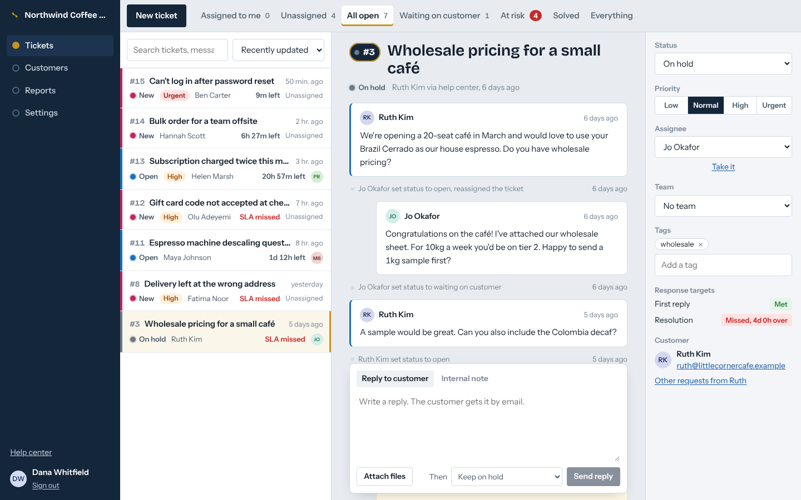
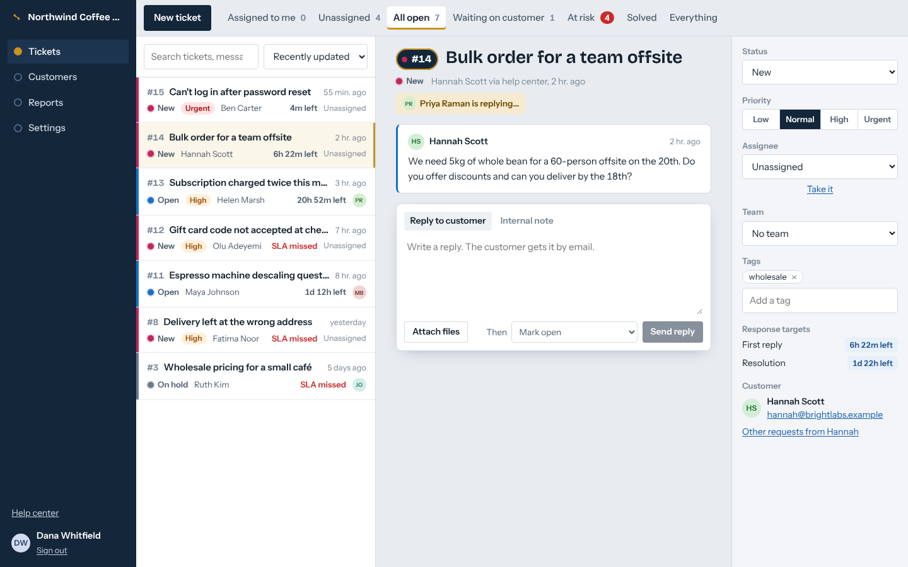
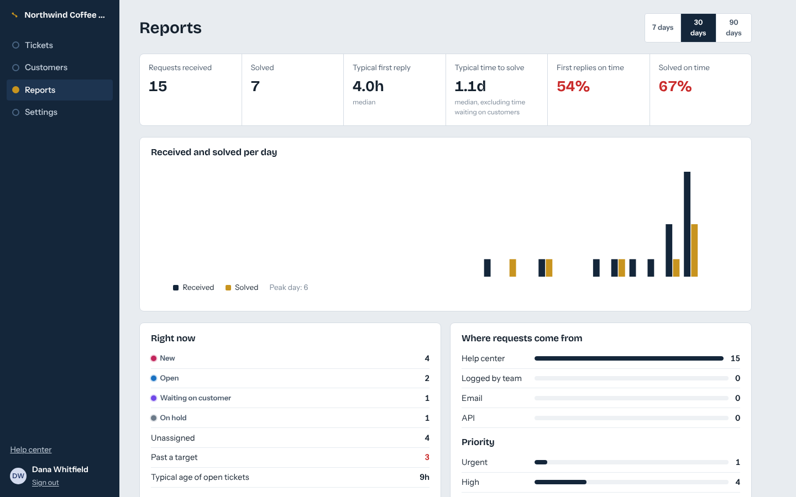
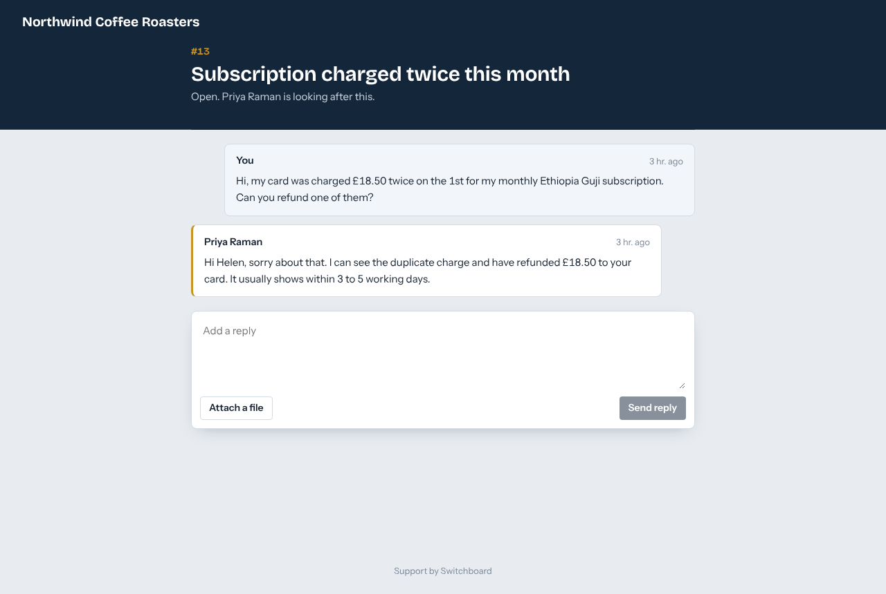

# Switchboard

Customer support and ticketing for small teams. Customers write in through a hosted help center and follow their request by email link. Agents work a shared inbox with live presence, internal notes, response targets and reports. Every organization's data is isolated by PostgreSQL row-level security.



## What it does

**For agents**
- A shared inbox with views (assigned to me, unassigned, waiting on customer, at risk), filters, sorting and paging. Counts update live.
- Full-text search across subjects and every message, including internal notes, with highlighted matches. Search by `#123` or by customer email too.
- Ticket view: public replies and internal notes, file attachments, "then mark solved/pending/on hold" in one step, and the full history of who changed what.
- Live collaboration over WebSockets. You see who else has the ticket open and when they start typing, so two people don't answer the same customer.
- Assignment rules: agents can take or drop tickets, and admins can assign anyone. Viewers have read-only access and can't be assigned.

**Response targets (SLAs)**
- First-reply and resolution targets per priority, with sensible defaults when an org is created.
- The clock pauses while a ticket is waiting on the customer and resumes when they reply. Changing priority recalculates the targets.
- A background scan flags misses once, records them in history, emails the assignee (or the admins if nobody is assigned) and pushes a live update.

**For customers**
- A help center at `/portal/{your-slug}`. There are no accounts or passwords: the emailed link is the credential. Links are signed, scoped to one customer and expire after 7 days.
- Customers can reply and attach files. They never see internal notes, history, tags or response targets.
- "Email me a link" resends access, with the same response whether or not the address is known. The request form has a honeypot and rate limits to stop bots.

**For admins**
- Invite people by email with a role: owner, admin, agent or viewer. Only owners can create or remove owners, and the last owner can't leave.
- Teams, response targets, help desk name and an activity log of every change.
- Reports: requests received and solved per day, typical first-reply and resolution times (excluding time waiting on the customer), on-time percentages, backlog, and per-person workload. All of it is computed in the viewer's time zone.

| Live presence | Reports | Customer view |
| --- | --- | --- |
|  |  |  |

## Architecture

```
            ┌────────────── nginx (web) ──────────────┐
 browser ──▶│ React app · /api → API · /socket.io → API│
            └───────────────────┬──────────────────────┘
                                ▼
                     NestJS API (n replicas) ──── Socket.IO ⇄ Redis adapter
                       │  │                         ▲
             SET LOCAL ROLE + org id                │ emitter (any process)
                       ▼  ▼                         │
                   PostgreSQL ◀──── worker ─────────┘
                   (RLS per org)    · email queue consumer (BullMQ → SMTP)
                                    · SLA breach scan, auto-close, upload cleanup
```

- **Tenant isolation in the database.** Every org-scoped request runs in a transaction that does `SET LOCAL ROLE switchboard_tenant` and sets `app.org_id`. Row-level security policies on every tenant table then filter by `current_org()`. A forgotten `WHERE org_id = …` can't leak data: the integration tests check this by querying as one org and looking for another's rows. Composite foreign keys `(org_id, id)` stop rows from pointing across tenants, and the tenant role can't even select `users.password_hash`.
- **Rules in one place.** `TicketsService` holds the status workflow, SLA maths, assignment checks and first-response tracking. Agent routes, the portal and background jobs all go through it.
- **Side effects after commit.** Emails go through a BullMQ queue (6 retries with backoff). Live events are published through Redis, so any API replica or the worker can reach every browser. A failure here never undoes a change that already succeeded.
- **Safe background jobs.** The worker takes a transaction-scoped advisory lock for each pass, so you can run several replicas.
- **Attachments.** Files are checked against an allow-list of types and their magic bytes, so a renamed `.html` can't pose as a `.png`. They're stored under random keys and served with `nosniff`, a sandboxing CSP and `Content-Disposition`. Uploads that never get attached to a message are removed after a day. `StorageService` is the seam for S3.
- **Auth.** argon2 password hashes. Login takes the same time whether or not the email exists. Sessions are httpOnly SameSite cookies. Invitation tokens are stored as SHA-256 hashes. Portal tokens use a separate JWT audience, so they're never accepted as agent sessions.

### Ticket statuses

```
new ──▶ open ⇄ pending ⇄ on_hold
  │       │       │         │
  └───────┴───────┴─────────┴──▶ solved ──▶ closed (final)
                                   │
                                   └──▶ open (reopened)
```

An agent's first public reply opens a `new` ticket. A customer reply moves `pending` or `solved` back to `open`. Solved tickets close automatically after `AUTO_CLOSE_HOURS` (default 7 days).

## Run it

### With Docker

```bash
cp .env.example .env          # set JWT_SECRET (openssl rand -hex 32)
docker compose up -d --build
docker compose run --rm migrate node dist/scripts/seed-demo.js   # optional demo data
```

- App: http://localhost:8080. With the demo data, sign in as `demo@switchboard.dev` / `switchboard-demo`.
- Help center: http://localhost:8080/portal/northwind
- Outgoing email (Mailpit): http://localhost:8025

To send real email, set `SMTP_URL` and `MAIL_FROM` in `.env`.

### Locally

Requires Node 22+, PostgreSQL 15+ and Redis 6+.

```bash
npm install
cp api/.env.example api/.env       # adjust DATABASE_URL / REDIS_URL if needed
createdb switchboard
npm run build -w api && npm run migrate && npm run seed:demo
npm run dev                        # API + worker on :4000, app on :5173
```

API docs (OpenAPI) are at http://localhost:4000/api/docs.

### Tests

```bash
createdb switchboard_test
npm test
```

69 tests run against real PostgreSQL and Redis. They cover:
- row-level security isolation
- auth, invitations and role rules
- the status workflow
- SLA pause and resume, breach scanning and auto-close
- search and inbox views
- attachments, including type and content checks and access control
- portal tokens and their scoping
- live presence and typing over real sockets
- email contents
- reports

Set `TEST_DATABASE_URL` and `TEST_REDIS_URL` to point the tests elsewhere.

## Deploy (Vercel + Render)

The app runs on Vercel, the API and worker on Render, PostgreSQL on any managed host (e.g. Supabase) and Redis on any managed host (e.g. Upstash). Vercel rewrites `/api/*` to Render, so the session cookie stays first-party. Vercel can't proxy WebSockets, so the live-updates socket connects to Render directly and authenticates with a two-minute token from `/api/auth/socket-token`.

1. **Render.** New → Blueprint, and pick this repository. `render.yaml` creates `switchboard-api` and `switchboard-worker` and runs migrations before each deploy. Fill in the variables it asks for:
   - `DATABASE_URL`: for Supabase, use the session pooler (port 5432). Transaction mode (6543) breaks the migration lock.
   - `APP_URL` and `CORS_ORIGIN`: your Vercel URL, e.g. `https://switchboard.vercel.app`.
   - `SMTP_URL` and `MAIL_FROM`: without them, invitations and portal links are only logged. For Brevo, use `smtp://<login>:<SMTP key>@smtp-relay.brevo.com:587`, writing the `@` in the login as `%40`. `MAIL_FROM` must be a sender verified in Brevo.
   - `S3_*`: a private bucket. For Supabase Storage, use the S3 endpoint `https://<project>.supabase.co/storage/v1/s3` with the project's region and S3 access keys.
2. **Vercel.** Import the repository and set **Root Directory** to `web`. Add `VITE_SOCKET_URL=https://switchboard-api.onrender.com`. If your Render URL is different, also replace it in `web/vercel.json` (the rewrite and the CSP `connect-src`).
3. Open the Vercel URL and register. To load demo data, open a shell on the API service and run `node dist/scripts/seed-demo.js`.

Background workers and pre-deploy commands need a paid Render instance type. Free web services also sleep when idle, which drops live updates.

## Configuration

| Variable | Default | |
| --- | --- | --- |
| `DATABASE_URL` | required | PostgreSQL 15+ |
| `REDIS_URL` | required | Queue, rate limits, presence, Socket.IO adapter |
| `JWT_SECRET` | required | At least 32 characters |
| `APP_URL` | `http://localhost:5173` | Used in email links |
| `CORS_ORIGIN` | `http://localhost:5173` | Only needed when the app and API are on different origins |
| `COOKIE_SECURE` | `false` | Set to `true` behind HTTPS |
| `SMTP_URL` | none | When empty, emails are logged as JSON |
| `MAIL_FROM` | `Switchboard <support@switchboard.local>` | |
| `STORAGE` | `local` | `local` (disk at `UPLOAD_DIR`) or `s3` |
| `UPLOAD_DIR` | `./uploads` | Mount a volume in production |
| `S3_BUCKET`, `S3_REGION`, `S3_ENDPOINT`, `S3_ACCESS_KEY_ID`, `S3_SECRET_ACCESS_KEY` | none | For `STORAGE=s3`. `S3_ENDPOINT` for non-AWS providers (R2, Supabase Storage, MinIO) |
| `DB_POOL_MAX` | `20` | Connections per process (API and worker each) |
| `TRUST_PROXY` | `loopback, uniquelocal` | Express trust proxy: a hop count or subnets. Decides the client IP used by rate limits |
| `MAX_UPLOAD_MB` | `10` | |
| `AUTO_CLOSE_HOURS` | `168` | |
| `RATE_LIMIT` | `true` | |

## Project layout

```
api/
  migrations/          SQL schema, RLS policies, grants
  src/
    tickets/           workflow, service (rules), queries (inbox, detail), controllers, storage
    portal/            customer endpoints and magic-link tokens
    orgs/              organizations, members, invitations, teams, SLA policies
    realtime/          Socket.IO gateway (presence, typing) and Redis publisher
    notifications/     email templates and queue, post-commit notifier
    jobs/ worker.ts    SLA scan, auto-close, upload cleanup, email delivery
    reports/           overview metrics
  test/                integration (real Postgres + Redis) and unit tests
web/
  src/pages/           inbox, ticket view, customers, reports, settings, portal
```

## License

MIT
